# Primer Suite — User Guide

Primer Suite designs PCR primers, checks where primers bind on a template, and tests whether a set of primers can be
mixed in one multiplex PCR without forming primer-dimers. It runs as a web page and as an offline desktop program
with exactly the same features. All calculations happen on your computer; no sequence is sent anywhere
(the only exception is the optional *Fetch from NCBI* button, which you trigger yourself).

---

## 1. Installing and starting

### Desktop version (no internet needed)

| System | File | How to start |
| --- | --- | --- |
| Windows | `Primer Suite-1.0.0-win.zip` | Unzip anywhere (e.g. `C:\Primer Suite`), open the folder, double-click `Primer Suite.exe`. If Windows SmartScreen warns, click *More info → Run anyway* (the app is unsigned). |
| Linux | `Primer Suite-1.0.0.AppImage` | Make it executable (`chmod +x`) and double-click, or run `./Primer\ Suite-1.0.0.AppImage`. |
| Linux (Debian/Ubuntu) | `primer-suite_1.0.0_amd64.deb` | `sudo dpkg -i primer-suite_1.0.0_amd64.deb`, then start *Primer Suite* from the application menu. |
| macOS | build with `npm run dist:mac` | Open the `.dmg`, drag *Primer Suite* to Applications. |

### Web version

* Open `src/index.html` directly in Chrome, Edge or Firefox, **or**
* run `node serve.js` (or double-click `start-web.bat` / `start-web.sh`) and open <http://localhost:8080>, **or**
* copy the `src/` folder to any web server.

Your inputs and settings are remembered between sessions in the browser/app storage.

---

## 2. The screen

Four tabs at the top:

| Tab | Use it to |
| --- | --- |
| **Primer Design** | Get ranked primer pairs for a template (optionally around a region of interest). |
| **Binding Check** | See where given primers bind on a template, including mismatched sites and all possible PCR products. |
| **Multiplex Dimers** | Test a set of primers for cross-dimers, self-dimers, hairpins and Tm spread; get pool suggestions. |
| **Settings** | Reaction conditions, organism background sequences, quick single-primer check, method notes. |

Each tab has an **input panel** on the left and a **results panel** on the right (stacked on narrow screens).
Buttons labelled *Export CSV* / *Export JSON* save the results as files; *Copy* buttons put sequences on the clipboard.

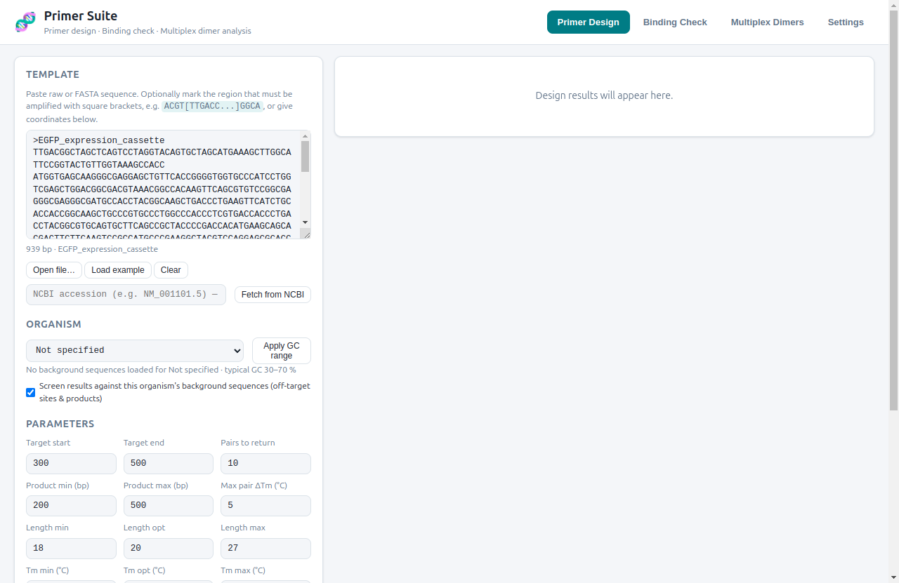

---

## 3. Entering sequences

### Templates (Primer Design, Binding Check)

Paste a DNA sequence into the text box in any of these forms:

* raw letters (`ATGC…`, spaces and numbers are ignored),
* FASTA (`>name` line followed by sequence),
* GenBank record text (sequence is taken from the `ORIGIN` block).

Other ways to load a template:

* **Open file…** — loads `.fasta`, `.fa`, `.fna`, `.txt`, `.gb`, `.gbk`, `.seq` files. GenBank files are converted to FASTA in the box.
* **Fetch from NCBI** — type an accession such as `NM_001101.5` or `NC_045512.2` and click the button (internet required).
* **Load example** — a 939 bp EGFP expression cassette to try the program with.

Degenerate IUPAC letters (N, R, Y, …) are accepted in templates and primers.

In *Binding Check* the template box may contain **several records** (multi-FASTA or several GenBank entries);
each record is scanned separately. In *Primer Design* only the first record is used.

### Primers (Binding Check, Multiplex Dimers)

One primer per line. Any of these line formats work and can be mixed:

```
EGFP_F  ATGGTGAGCAAGGGCGAGGAG      name, spaces/tab, sequence
EGFP_R,TTACTTGTACAGCTCGTCCATGC     name, comma, sequence
>Actin_F                            FASTA
CATGTACGTTGCTATCCAGGC
GAAGGTGAAGGTCGGAGTC                 bare sequence (named Primer1, Primer2, …)
```

*Open primer file…* loads a FASTA, text, CSV or TSV list and appends it to the box.

---

## 4. Primer Design

### Steps

1. Paste or load the template.
2. (Optional) mark the **target** — the part that must be inside the PCR product. Either type *Target start* / *Target end*
   (1-based positions) or put square brackets in the sequence itself: `ACGT[GGCCAATT…]TTGA`.
   Without a target, pairs are designed anywhere on the template.
3. (Optional) choose the **organism** and press *Apply GC range* to use GC limits typical for it.
4. Check the parameters (defaults are good for standard PCR) and click **Design primers**.

### Parameters

| Parameter | Meaning | Default |
| --- | --- | --- |
| Product min / max | Allowed PCR product length (bp). | 100 – 1000 |
| Pairs to return | How many ranked pairs to list. | 10 |
| Max pair ΔTm | Largest Tm difference allowed between forward and reverse primer. | 5 °C |
| Length min / opt / max | Primer length limits and preferred length. | 18 / 20 / 27 |
| Tm min / opt / max | Primer melting temperature limits and preferred Tm. | 57 / 60 / 63 °C |
| GC min / max | Allowed GC content. | 30 – 70 % |
| Max poly-X run | Longest run of one base allowed (e.g. AAAAA). | 4 |
| Max self-dimer ΔG | Reject primers whose self-dimer is more stable (more negative) than this. | −8 kcal/mol |
| Max hairpin ΔG | Reject primers with a more stable hairpin. | −3 kcal/mol |
| Max pair-dimer ΔG | Reject pairs whose cross-dimer is more stable. | −8 kcal/mol |
| Require GC clamp | At least one G or C within the last five 3′ bases. | on |
| Reject non-unique 3′ 12-mer | Discard primers whose last 12 bases occur twice in the template (either strand). | on |
| Screen against background | After design, scan each pair against the organism's background sequences (see §7). | on |

Primers are also rejected when the last five 3′ bases contain more than three G/C (too "sticky") or when their 3′
pentamer is more stable than −9 kcal/mol, and when dinucleotide repeats exceed 4 units.

### Reading the results

Pairs are listed best first. Each card shows:

* **Penalty** — lower is better (sum of deviations from optimum Tm/length/GC plus structure and ΔTm penalties).
* **Product** size, coordinates and GC %.
* **ΔTm** between the two primers, **pair dimer ΔG** and, if the 3′ ends overlap, the **3′ stem ΔG**.
* A table per primer: sequence (5′→3′, ready to order), position on the template, length, Tm, GC %,
  self-dimer ΔG, hairpin ΔG, 3′-end stability (ΔG of the last five bases).
* Coloured badges: green = fine, amber = worth a look, red = problem.
* If background screening ran: *no background hits*, *N background sites*, or *N off-target products* (red).

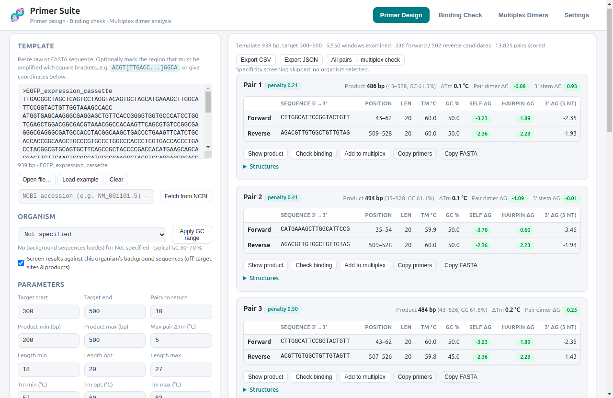

Buttons on each card:

* **Show product** — the amplicon sequence with the primers highlighted (copy button inside).

  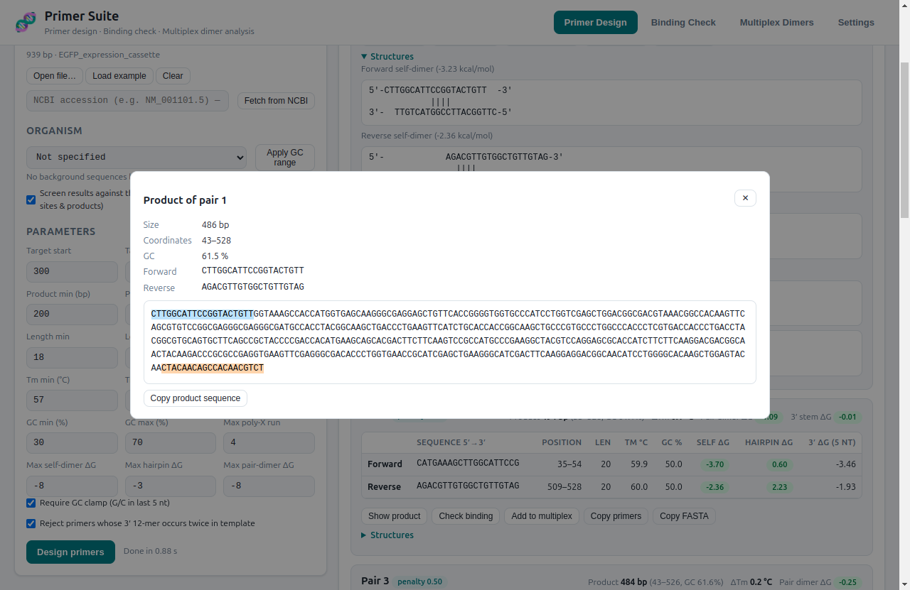

* **Check binding** — sends template and pair to *Binding Check*.
* **Add to multiplex** — appends the pair to the multiplex set. *All pairs → multiplex check* does this for every pair.
* **Copy primers / Copy FASTA**.
* **Structures** — the self-dimer, cross-dimer and hairpin alignments behind the numbers.

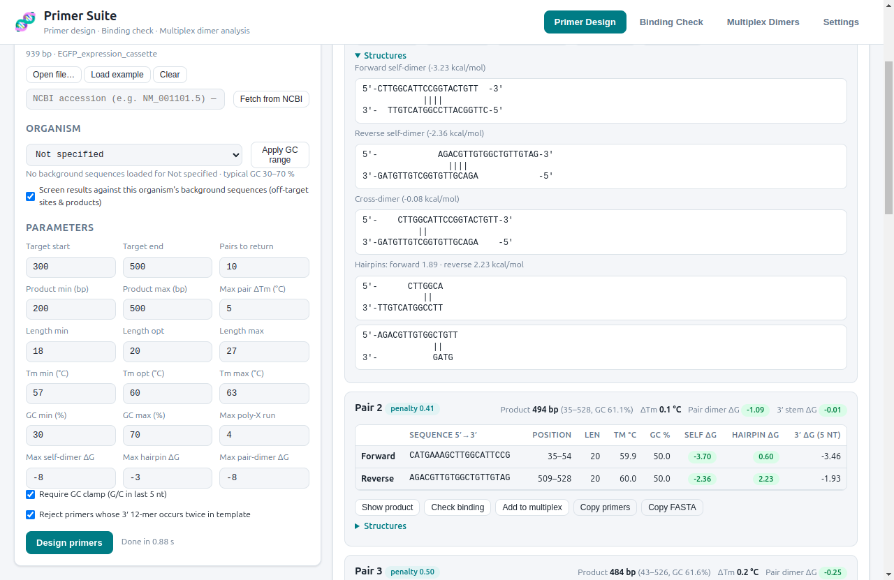

If no pair is found, the warning tells you whether forward or reverse candidates were missing; relax Tm, length, GC
or product size, or widen the target.

---

## 5. Binding Check

Shows every place a primer can anneal on a template, including partial matches, and all products that any
forward/reverse combination could make.

1. Paste the template (one or many records) and the primers.
2. Set **Max mismatches** (default 3) — sites with more mismatches are ignored.
   **Max product** limits the product length considered. **Max sites / primer** caps the output for repetitive templates.
3. Tick *Also scan this organism's background sequences* to include the library from §7.
4. Click **Check binding**.

Results:

* **Summary table** of the primers (Tm, GC, self-dimer, hairpin, number of sites and perfect sites).
* For each template record:
  * a **binding map** — coloured bars on the + strand (upper row) and − strand (lower row); faded bars are mismatched sites; hover for details;
  * **Predicted products** — forward site × reverse site combinations: size, mismatches, whether both 3′ ends are matched,
    *perfect* / *mismatched*, and *single-primer* when the same primer makes both ends. *View* shows the product sequence;

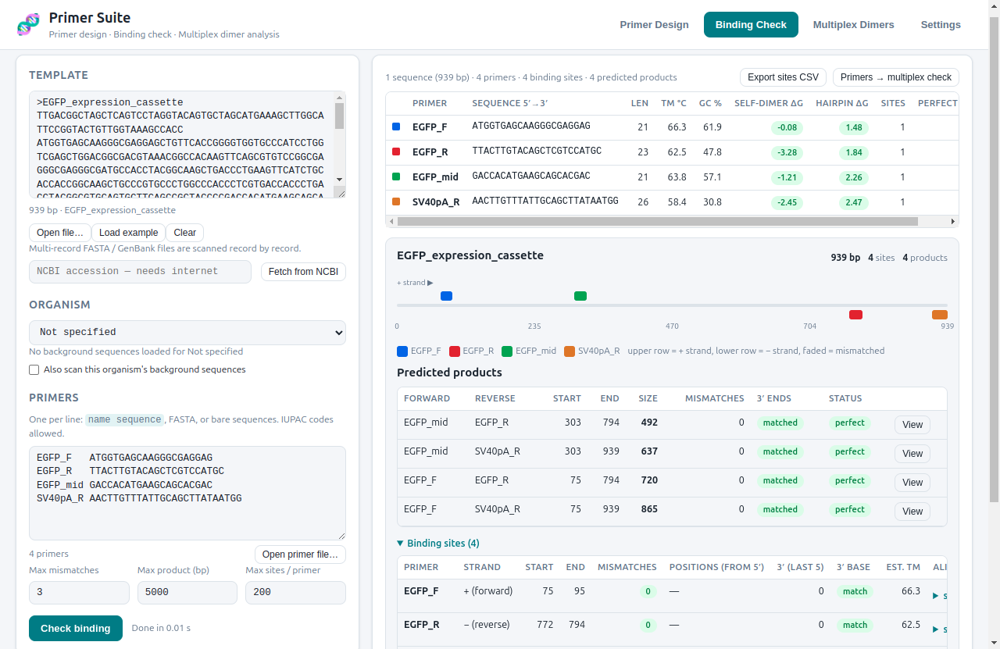
  * **Binding sites** — strand, position, number and positions of mismatches (counted from the primer's 5′ end),
    mismatches in the last five 3′ bases, whether the 3′-terminal base matches, estimated Tm of the mismatched duplex,
    and an alignment (*show*).

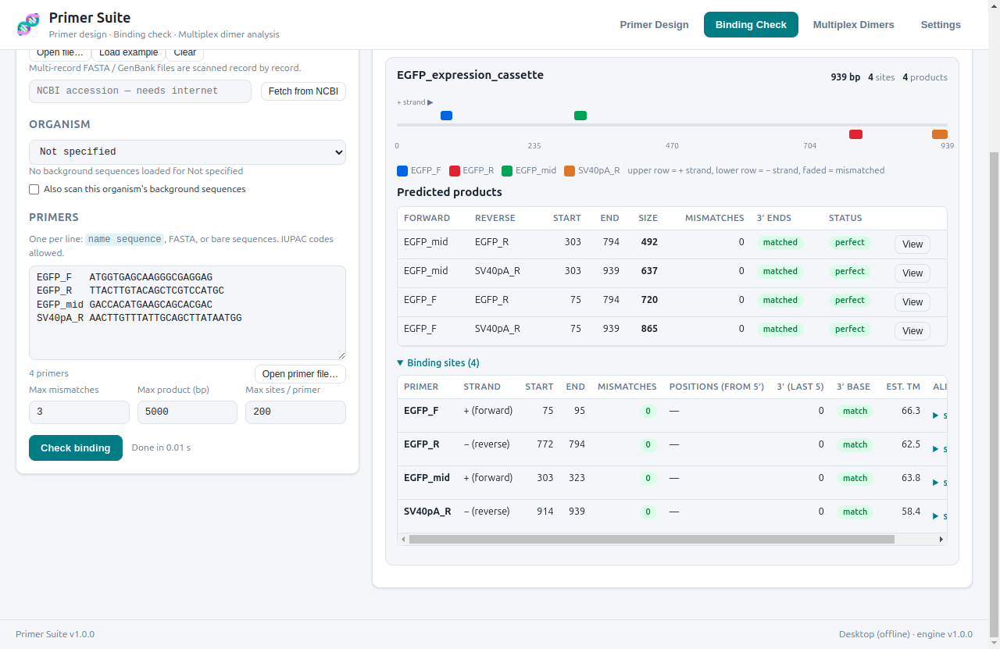

Interpretation: a site with a mismatched **3′ base** rarely primes; extra products with matched 3′ ends and sizes close
to the intended one are the ones that will show on a gel.

---

## 6. Multiplex Dimers

Checks whether primers can share one PCR tube.

1. Enter all primers of the planned mix (both primers of every pair). The primer set is a numbered list:
   * every row has a number, a **name** (filled in automatically as *Primer 1*, *Primer 2*, … and editable) and a
     **sequence** field (5′→3′); the length appears next to it;
   * **+ Add primer** appends a new numbered row, and pressing **Enter** in a sequence field does the same;
   * **×** removes a row; the numbers update;
   * **Paste list…** opens a box for pasting many primers at once (name + sequence per line, FASTA or bare sequences),
     either added to the list or replacing it; **Open primer file…** does the same from a file;
   * *All pairs → multiplex check* in *Primer Design* and *Primers → multiplex check* in *Binding Check* fill the list for you.

   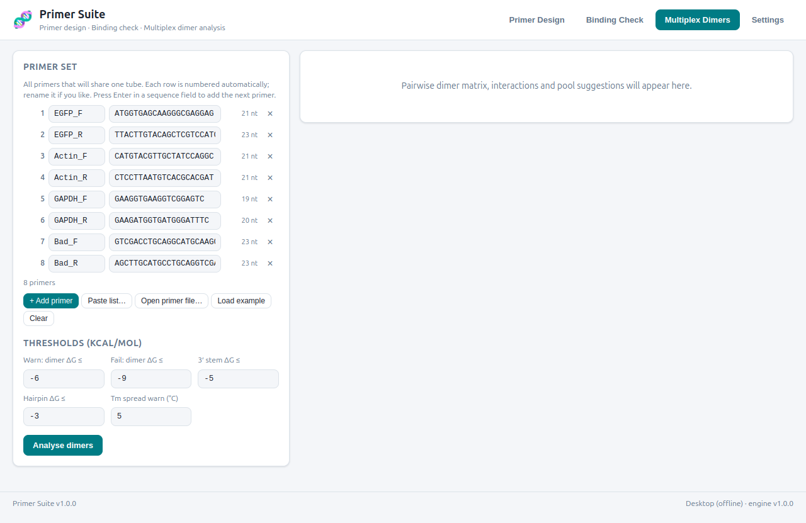

   After *+ Add primer* a new row appears with the next number:

   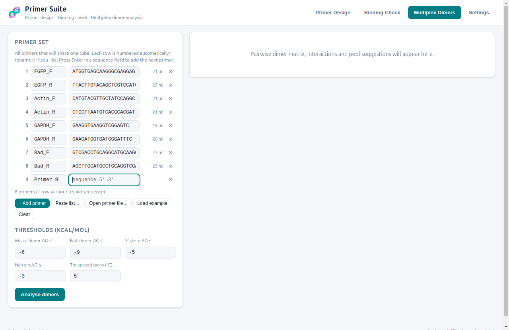
2. Thresholds (kcal/mol): **Warn** (default −6) and **Fail** (−9) for any dimer, **3′ stem** (−5) for dimers that
   include a primer's 3′-terminal base, **Hairpin** (−3), and the acceptable **Tm spread** (5 °C).
3. Click **Analyse dimers**.

Results:

* **Verdict banner** — *Compatible*, *Use with caution*, or *Incompatible*, with counts of failing/warning
  interactions, Tm range and the number of pools needed.

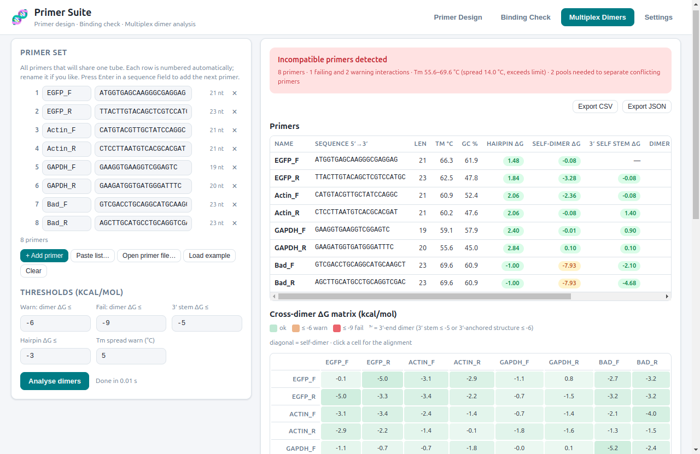
* **Primer table** — per primer: Tm, GC, hairpin, self-dimer, 3′ self stem ΔG, **Dimer events** (how many problematic
  dimers the primer takes part in), the partners involved, and flags.
* **Cross-dimer ΔG matrix** — heat-map of every primer against every other (diagonal = self-dimer). Green = fine,
  amber = warning, red = fail. A ³′ mark means a 3′-end dimer. Click a cell to see the alignment.

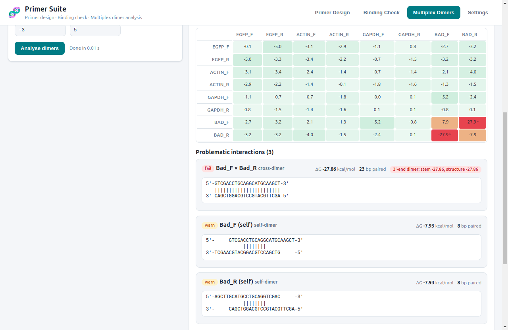
* **Problematic interactions** — sorted worst first, each with the base-pairing drawn out:

  ```
  5'-GTCGACCTGCAGGCATGCAAGCT-3'
     |||||||||||||||||||||||
  3'-CAGCTGGACGTCCGTACGTTCGA-5'
  ```

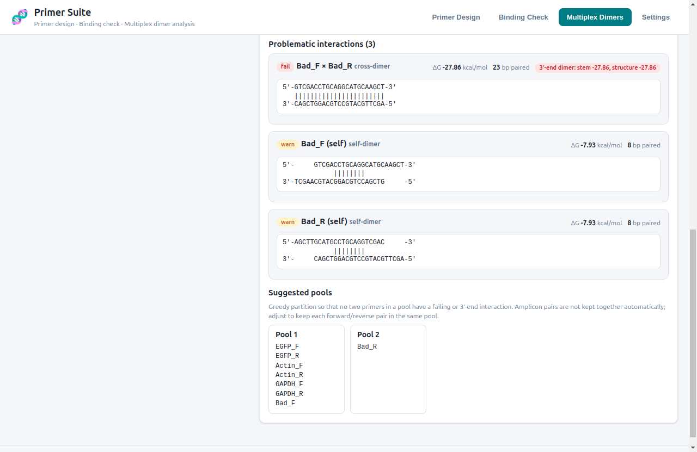

* **Suggested pools** — a split of the primers into groups with no failing or 3′-end interaction inside a group.
  Keep each forward/reverse pair in the same pool when you adapt the suggestion.

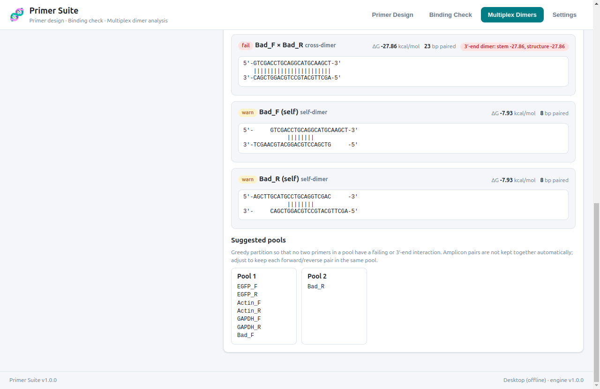

Rules of thumb: ΔG above −6 is normally harmless; −6 to −9 may reduce yield; below −9, or any 3′-end dimer below
−5, usually produces visible primer-dimer. Keep Tm within about 5 °C across the mix.

---

## 7. Organisms and background sequences

The **Organism** list (Primer Design, Binding Check, Settings) is shared by all tabs. Choosing one:

* offers a typical GC range for design (*Apply GC range*);
* selects which **background sequence library** is used for specificity checks.

To load a library: *Settings → Organisms & background sequences* → choose the organism → **Add sequence files…** and
select FASTA or GenBank files (genome, chromosome, transcript set, plasmids, previous amplicons…). The files are stored
inside the app/browser and remain available offline. Use *remove* or *Remove all* to manage them.

How screening works: each primer is scanned against every record on both strands allowing up to 2 mismatches, but the
last 3 bases of the 3′ end must match. Every forward/reverse site combination within 4 kb is reported as a potential
product; a product identical to the intended one is labelled *intended*, anything else *off-target*.

Size guidance: bacterial genomes, viral genomes, transcript sets and plasmid collections scan in seconds.
Whole mammalian genomes (gigabases) are too large for in-browser scanning; use the relevant chromosome, gene region
or a transcript set instead.

---

## 8. Settings

**Reaction conditions** affect every Tm and ΔG in the program:

| Setting | Default | Note |
| --- | --- | --- |
| Na⁺ / K⁺ | 50 mM | monovalent cations of the buffer |
| Mg²⁺ | 1.5 mM | free Mg²⁺ is computed as Mg²⁺ − dNTP |
| dNTPs total | 0.8 mM | e.g. 0.2 mM each |
| Primer concentration | 250 nM | |
| ΔG temperature | 37 °C | temperature at which dimer/hairpin ΔG is reported |

Click **Save** to keep them. **Quick primer check** analyses one primer (Tm, GC, dimers, hairpin, reverse complement).

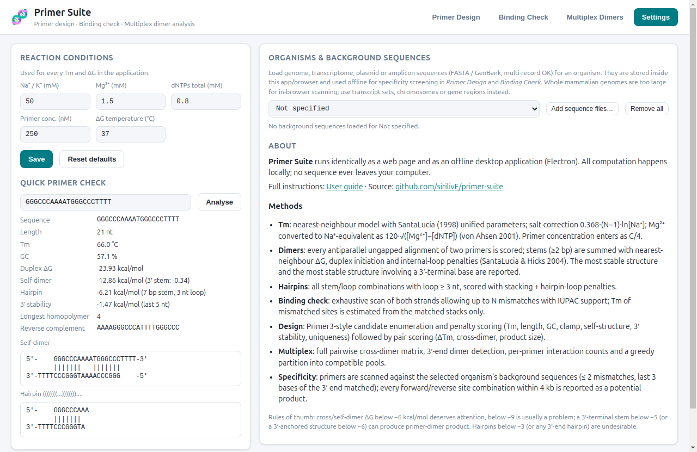

---

## 9. Typical workflows

**Design a pair for a gene region**
Primer Design → paste gene → set target → *Design primers* → *Show product* to confirm → *Copy FASTA* to order.

**Check primers from a paper on your sequence**
Binding Check → paste template and primers → look for perfect sites with matched 3′ ends and one product of the expected size.

**Build a multiplex panel**
Design each pair (or paste existing ones) → *Add to multiplex* → Multiplex Dimers → fix red interactions by
redesigning one primer of the conflicting pair (change its position or length) → re-analyse until the verdict is
*Compatible* or *Use with caution* → check the Tm spread.

**Check specificity in an organism**
Settings → load the organism's transcript set or genome region → choose the organism in Primer Design →
design → read the specificity badge on each pair.

---

## 10. Troubleshooting

| Problem | What to do |
| --- | --- |
| *Please paste a template sequence* | The box is empty or contains fewer than 40 valid bases. |
| No pairs found | Read the warning under the results header; widen Tm/GC/length/product limits or the target region. |
| Design is slow | Long templates without a target examine every window. Set a target region or a narrower product size range. |
| Fetch from NCBI fails | Needs internet; check the accession spelling; some corporate networks block eutils.ncbi.nlm.nih.gov. |
| Background screening skipped | No organism selected, or no sequences loaded for it in Settings. |
| Windows says the app is unrecognised | The executable is not code-signed. Choose *More info → Run anyway*. |
| Results differ slightly from other tools | Different programs use different thermodynamic parameters, salt corrections and primer concentrations. Match the Settings to compare. |

---

## 11. Methods in brief

* **Tm**: nearest-neighbour model with SantaLucia (1998) unified parameters; salt correction 0.368·(N−1)·ln[Na⁺];
  Mg²⁺ converted to a Na⁺ equivalent as 120·√([Mg²⁺]−[dNTP]) (von Ahsen et al. 2001).
* **Dimers**: every antiparallel ungapped alignment of two primers is scored with nearest-neighbour stacking,
  duplex initiation and internal-loop penalties (SantaLucia & Hicks 2004); the most stable structure and the most
  stable structure involving a 3′-terminal base are reported.
* **Hairpins**: all stem/loop combinations with loop ≥ 3 nt, stacking plus hairpin-loop penalties.
* **Binding**: exhaustive scan of both strands; Tm of mismatched sites estimated from the matched stacks only.
* **Design**: Primer3-style enumeration of all candidate windows, filtering, penalty scoring and pair scoring.
